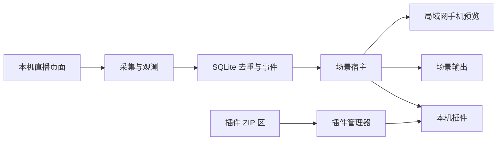

# 架构速览

工作站只有一个事件入口。所有场景插件都从宿主接收事件，因此测试热键和真实礼物走同一条分发路径。插件安装使用本机 ZIP 描述，运行时不依赖官网或远程发布服务。

本机数据位于 Electron `userData`：`studio.sqlite` 保存设置和事件，`plugins/` 保存插件版本，`plugins/inbox/` 是 ZIP 投递目录，`scene-assets/` 保存导入素材。卸载插件不会自动删除插件数据，便于重新安装恢复配置。
